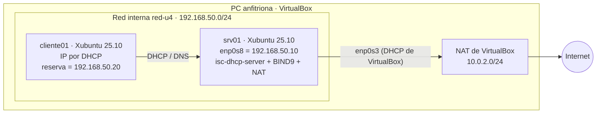

# Tarea 4.1 — Servicios de infraestructura base: DHCP y DNS

**Materia:** Administración de Servidores · **Unidad 4**
**Sistema probado:** Xubuntu 25.10 (VirtualBox) · ISC DHCP 4.4.3 · BIND 9.20

Este trabajo configura un servidor Linux que reparte direcciones IP por **DHCP** y resuelve los nombres del dominio corporativo **`empresa.lan`** con **DNS**:

- **DHCP:** rango dinámico, exclusiones, tiempos de concesión y reservas por MAC.
- **DNS:** zona directa e inversa; registros A, CNAME, PTR, MX y NS; reenviadores a internet.

---

## 1. Plan de direccionamiento IP

### 1.1 Red corporativa (diseño)

La empresa usa el bloque privado **192.168.48.0/21** (192.168.48.0 – 192.168.55.255). Ese bloque se divide en una VLAN por área:

| VLAN | Segmento | Red | Máscara | Hosts útiles | Puerta de enlace | Rango DHCP |
|---|---|---|---|---|---|---|
| 10 | Operaciones | 192.168.48.0/24 | 255.255.255.0 | 254 | 192.168.48.1 | .100 – .200 |
| 20 | Finanzas | 192.168.49.0/24 | 255.255.255.0 | 254 | 192.168.49.1 | .100 – .200 |
| **30** | **Sistemas y servidores** | **192.168.50.0/24** | 255.255.255.0 | 254 | **192.168.50.10** | **.100 – .200** |
| 40 | Dirección | 192.168.51.0/25 | 255.255.255.128 | 126 | 192.168.51.1 | .50 – .120 |
| 50 | Impresoras y dispositivos | 192.168.51.128/26 | 255.255.255.192 | 62 | 192.168.51.129 | Solo reservas |
| 99 | Administración de red | 192.168.51.192/27 | 255.255.255.224 | 30 | 192.168.51.193 | Sin DHCP (IP fijas) |
| 60 | Wi-Fi de invitados | 192.168.52.0/23 | 255.255.254.0 | 510 | 192.168.52.1 | .10 – 192.168.53.250 |
| — | Reserva para crecimiento | 192.168.54.0/23 | — | 510 | — | — |

**En el laboratorio se implementa la VLAN 30**, que es donde están los servidores. Como no hay router, el propio servidor hace de puerta de enlace: enruta y aplica NAT hacia internet.

### 1.2 Segmento implementado: 192.168.50.0/24

| Direcciones | Uso |
|---|---|
| 192.168.50.1 – .19 | IP fijas de servidores y equipos de red (no las da DHCP) |
| **192.168.50.10** | **srv01**: DHCP, DNS (ns1), web, correo y puerta de enlace |
| 192.168.50.20 – .49 | **Reservas por MAC** (cliente01 = .20, impresora01 = .21) |
| 192.168.50.50 – .99 | Libre para crecimiento |
| **192.168.50.100 – .200** | **Rango dinámico** |
| 192.168.50.150 – .159 | **Exclusión** dentro del rango (equipos temporales con IP fija) |
| 192.168.50.255 | Difusión (broadcast) |

| Parámetro DHCP | Valor |
|---|---|
| Concesión por defecto | 3600 s (1 hora) |
| Concesión máxima | 14400 s (4 horas) |
| Puerta de enlace | 192.168.50.10 |
| Servidor DNS | 192.168.50.10 |
| Dominio / búsqueda | empresa.lan |

## 2. Arquitectura del laboratorio



| VM | Adaptador | Conectado a | Interfaz | IP |
|---|---|---|---|---|
| Servidor | 1 | NAT | enp0s3 | 10.0.2.15 (la asigna VirtualBox) |
| Servidor | 2 | Red interna `red-u4` | enp0s8 | 192.168.50.10/24 (fija) |
| Cliente | 1 | Red interna `red-u4` | enp0s3 | Por DHCP desde srv01 |

## 3. Zonas DNS de `empresa.lan`

| Nombre | Tipo | Valor |
|---|---|---|
| empresa.lan | NS | ns1.empresa.lan. |
| empresa.lan | MX 10 | mail.empresa.lan. |
| empresa.lan, srv01, ns1, mail | A | 192.168.50.10 |
| cliente01 | A | 192.168.50.20 |
| impresora01 | A | 192.168.50.21 |
| www, ftp, intranet | CNAME | srv01.empresa.lan. |
| webmail | CNAME | mail.empresa.lan. |
| 10.50.168.192.in-addr.arpa | PTR | srv01.empresa.lan. |
| 20.50.168.192.in-addr.arpa | PTR | cliente01.empresa.lan. |
| 21.50.168.192.in-addr.arpa | PTR | impresora01.empresa.lan. |

**Reenviadores:** las consultas que no son de `empresa.lan` se envían a 8.8.8.8 y 1.1.1.1 (`forward first`).

## 4. Estructura del repositorio

```
Unidad_4/Tarea_4.1/
├── config/
│   ├── dhcpd.conf            # -> /etc/dhcp/dhcpd.conf
│   ├── named.conf            # -> /etc/bind/named.conf
│   ├── named.conf.options    # -> /etc/bind/named.conf.options (ACL, reenviadores)
│   ├── named.conf.local      # -> /etc/bind/named.conf.local   (declaración de zonas)
│   ├── db.empresa.lan        # -> /etc/bind/zones/db.empresa.lan (zona directa)
│   ├── db.rev                # -> /etc/bind/zones/db.rev         (zona inversa)
│   └── nat-tarea41.nft       # -> /etc/tarea41/nat.nft  (NAT para los clientes)
├── scripts/
│   ├── lib/comun.sh          # Variables y funciones compartidas
│   ├── 00_ejecutar_todo.sh   # Ejecuta 01, 02, 03 y 99 en orden
│   ├── 01_red_servidor.sh    # IP fija en enp0s8, reenvío y NAT
│   ├── 02_dhcp.sh            # Instala y configura isc-dhcp-server
│   ├── 03_dns.sh             # Instala y configura BIND9
│   ├── 98_revertir.sh        # Deshace todo
│   ├── 99_validar.sh         # Evidencia + pruebas automáticas (servidor)
│   └── cliente_pruebas.sh    # Pruebas desde la VM cliente
└── evidencias/               # Se crea al ejecutar 99_validar.sh
```

## 5. Uso

### En el servidor

```bash
git clone https://github.com/<tu-usuario>/<tu-repo>.git
cd <tu-repo>/Unidad_4/Tarea_4.1

# Todo de una vez (la MAC del cliente ya esta en config/dhcpd.conf;
# para otra VM cliente: ... 00_ejecutar_todo.sh --mac 08:00:27:aa:bb:cc)
sudo bash scripts/00_ejecutar_todo.sh

# O paso por paso
sudo bash scripts/01_red_servidor.sh
sudo bash scripts/02_dhcp.sh
sudo bash scripts/03_dns.sh
sudo bash scripts/99_validar.sh

# Ver las solicitudes DHCP en tiempo real
sudo journalctl -u isc-dhcp-server -f

# Volver al estado inicial
sudo bash scripts/98_revertir.sh
```

### En el cliente

```bash
bash scripts/cliente_pruebas.sh                  # IP recibida + pruebas DNS
bash scripts/cliente_pruebas.sh --renovar        # renovar la concesión
bash scripts/cliente_pruebas.sh --mac-aleatoria  # otra MAC -> IP del rango dinámico
bash scripts/cliente_pruebas.sh --mac-original   # MAC real -> IP reservada .20
```

## 6. Pruebas de verificación

| Prueba | Dónde | Comando | Resultado esperado |
|---|---|---|---|
| Reserva por MAC | Cliente | `ip -br addr` | 192.168.50.20 |
| Asignación dinámica | Cliente | `cliente_pruebas.sh --mac-aleatoria` | IP entre .100 y .200, nunca .150 – .159 |
| Renovación de la concesión | Cliente / servidor | `--renovar` y `journalctl -u isc-dhcp-server -f` | DHCPDISCOVER → OFFER → REQUEST → ACK |
| Concesiones entregadas | Servidor | `cat /var/lib/dhcp/dhcpd.leases` | Bloque `lease` por cada IP dinámica |
| Resolución directa | Cliente | `nslookup www.empresa.lan` | Alias de srv01.empresa.lan → 192.168.50.10 |
| Resolución inversa | Cliente | `nslookup 192.168.50.10` / `dig -x 192.168.50.20` | srv01.empresa.lan / cliente01.empresa.lan |
| Registro MX | Cliente | `dig empresa.lan MX +short` | 10 mail.empresa.lan. |
| Reenviadores | Cliente | `dig www.google.com +short` | IP pública de Google |
| Sintaxis | Servidor | `named-checkconf`, `named-checkzone`, `dhcpd -t` | Sin errores |

## 7. Notas

- Se usa el dominio **`empresa.lan`** y no `.local`, porque Linux reserva `.local` para mDNS (Avahi). Con `.local`, el navegador y el correo del cliente no resolverían los nombres.
- Al **cambiar una zona**, aumenta el número **serial** del SOA y recarga con `sudo rndc reload`.
- Las reservas por MAC (`fixed-address`) **no se guardan** en `dhcpd.leases`; se comprueban con el log (`DHCPACK on 192.168.50.20`).
- Si los scripts dan error `$'\r': command not found`, conviértelos a fin de línea Unix con `sed -i 's/\r$//' scripts/*.sh scripts/lib/*.sh`.
