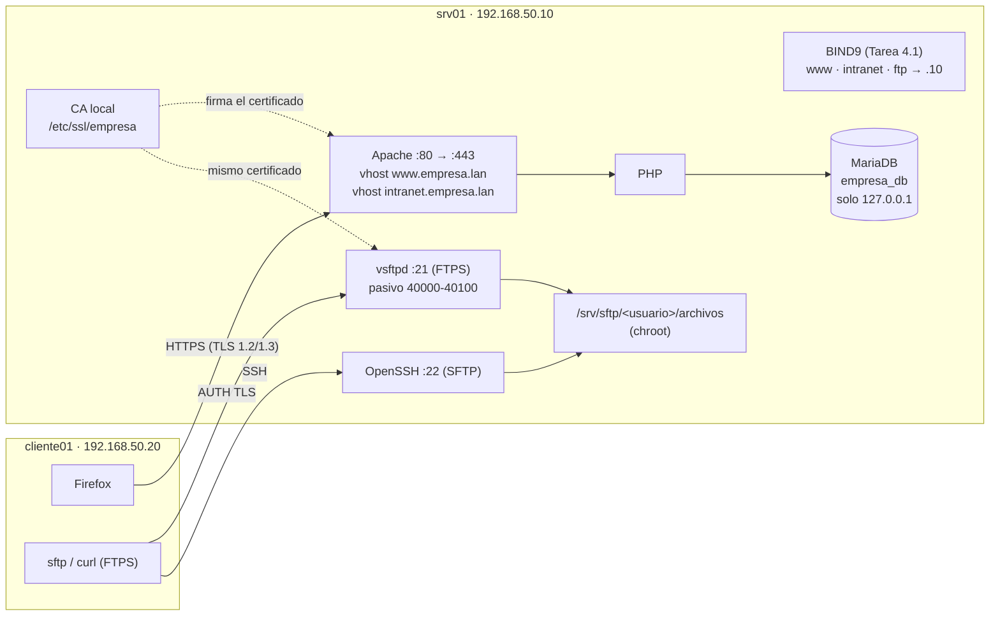

# Tarea 4.2 — Servicios web (HTTPS) y transferencia de archivos (FTPS/SFTP)

**Materia:** Administración de Servidores · **Unidad 4**
**Sistema probado:** Xubuntu 25.10 (VirtualBox) · Apache 2.4 · PHP 8 · MariaDB · vsftpd 3 · OpenSSH

Sobre el laboratorio de la [Tarea 4.1](../Tarea_4.1/) (DNS `empresa.lan`, red `192.168.50.0/24`), el servidor `srv01` ofrece:

- **Stack web dinámico:** Apache + PHP + MariaDB, con dos **virtual hosts** (`www.empresa.lan` e `intranet.empresa.lan`).
- **HTTPS:** certificados firmados por una **autoridad certificadora (CA) local**. HTTP redirige a HTTPS, solo se aceptan TLS 1.2 y 1.3, y se envían cabeceras de seguridad.
- **Archivos:** **FTPS** con vsftpd y **SFTP** con OpenSSH:
  - Usuarios locales **enjaulados (chroot)**.
  - **Sin acceso anónimo**.
  - Contraseñas que nunca viajan sin cifrar.

---

## 1. Topología de servicios



| Servicio | Puerto | Nombre | Seguridad aplicada |
|---|---|---|---|
| HTTP | 80/TCP | www / intranet | Solo redirige a HTTPS (y sirve `/ca.crt`) |
| HTTPS | 443/TCP | www.empresa.lan | TLS 1.2/1.3, HSTS, cabeceras, sin versión de Apache/PHP |
| HTTPS | 443/TCP | intranet.empresa.lan | Lo anterior + **solo red 192.168.50.0/24** |
| MariaDB | 3306/TCP | — | Solo `127.0.0.1`; usuario `webapp` con permiso **SELECT** |
| FTPS | 21/TCP + 40000-40100 | ftp.empresa.lan | Sin anónimo, lista blanca, **TLS obligatorio**, chroot |
| SFTP | 22/TCP | ftp.empresa.lan | Grupo `sftpusuarios`: solo SFTP, sin terminal, chroot |

## 2. Certificados (CA local)

| Archivo | Contenido |
|---|---|
| `/etc/ssl/empresa/ca.crt` | Certificado de la CA "Empresa LAN - CA raiz" (10 años). Los clientes lo importan |
| `/etc/ssl/empresa/private/ca.key` | Llave privada de la CA (600, solo root) |
| `/etc/ssl/empresa/servidor.crt` | Certificado del servidor, firmado por la CA (825 días) |
| `/etc/ssl/empresa/private/servidor.key` | Llave privada del servidor (600) |

Un solo certificado sirve para todos los nombres del servidor gracias a los **SAN** (nombres alternativos): `www.empresa.lan`, `empresa.lan`, `intranet.empresa.lan`, `ftp.empresa.lan`, `srv01.empresa.lan` e `IP:192.168.50.10`.

¿Por qué una CA local y no Let's Encrypt? Let's Encrypt solo emite certificados para dominios públicos que pueda verificar desde internet, y `empresa.lan` es un dominio interno. Con una CA propia, basta importar `ca.crt` una vez en cada equipo para que confíe en todos los certificados que la CA firme.

## 3. Usuarios FTP/SFTP y jaulas

| Usuario | Shell | Jaula (raíz "/") | Puede escribir en |
|---|---|---|---|
| ftp_ventas | `/usr/sbin/nologin` | `/srv/sftp/ftp_ventas` (root, 755) | `/archivos` |
| ftp_soporte | `/usr/sbin/nologin` | `/srv/sftp/ftp_soporte` (root, 755) | `/archivos` |

- Al entrar, el usuario ve `/` = su carpeta. No puede subir a `/srv`, `/etc` ni ver la carpeta del otro usuario.
- La raíz de la jaula debe pertenecer a root y no ser escribible: OpenSSH y vsftpd lo exigen por seguridad. Por eso el usuario escribe dentro de `archivos/`.
- vsftpd y SFTP usan **la misma jaula**: un archivo subido por FTPS aparece por SFTP.
- Las contraseñas se generan al instalar y quedan en `/root/tarea42_credenciales.txt` (solo root).

## 4. Estructura del repositorio

```
Unidad_4/Tarea_4.2/
├── config/
│   ├── apache/
│   │   ├── www.empresa.lan.conf        # vhost público (80 → 443)
│   │   ├── intranet.empresa.lan.conf   # vhost intranet (solo red interna)
│   │   └── tarea42-seguridad.conf      # cifrado SSL/TLS y cabeceras
│   ├── ssl/
│   │   ├── ca.cnf                      # datos de la CA local
│   │   └── servidor.cnf                # CSR y nombres (SAN) del servidor
│   ├── vsftpd.conf                     # FTPS con chroot, sin anónimo
│   ├── vsftpd-tarea42.pam              # PAM de vsftpd (usuarios con nologin)
│   ├── sshd-sftp.conf                  # SFTP enjaulado (Match Group)
│   └── empresa_db.sql                  # base de datos de las páginas
├── sitio/
│   ├── www/index.php                   # página de prueba: TLS + PHP + MariaDB
│   └── intranet/index.php              # página de la intranet
├── scripts/
│   ├── lib/comun.sh
│   ├── 00_ejecutar_todo.sh             # 01 → 02 → 03 → 04 → 99
│   ├── 01_web_lamp.sh                  # Apache, PHP, MariaDB y páginas
│   ├── 02_certificados.sh              # CA local y certificado del servidor
│   ├── 03_https_vhosts.sh              # virtual hosts con HTTPS
│   ├── 04_ftp_sftp.sh                  # usuarios, jaulas, vsftpd y SFTP
│   ├── 98_revertir.sh                  # deshace todo (no toca la 4.1)
│   ├── 99_validar.sh                   # pruebas automáticas (servidor)
│   └── cliente_pruebas.sh              # pruebas desde la VM cliente
└── evidencias/                         # se crea al ejecutar 99_validar.sh
```

## 5. Uso

### En el servidor

Requiere la Tarea 4.1 funcionando.

```bash
cd <tu-repo>/Unidad_4/Tarea_4.2
git pull

# Todo de una vez
sudo bash scripts/00_ejecutar_todo.sh
# (opcional) misma contraseña para los usuarios FTP: ... 00_ejecutar_todo.sh --password <clave>

# Ver las contraseñas de ftp_ventas y ftp_soporte
sudo cat /root/tarea42_credenciales.txt

# Volver al estado inicial
sudo bash scripts/98_revertir.sh
```

### En el cliente

```bash
bash scripts/cliente_pruebas.sh confiar-ca   # una vez: importa la CA (sistema y Firefox)
bash scripts/cliente_pruebas.sh web          # redirección, certificado, TLS, vhosts
bash scripts/cliente_pruebas.sh ftps         # anónimo, sin cifrar y con TLS

sftp ftp_ventas@ftp.empresa.lan              # sesión SFTP enjaulada
```

## 6. Pruebas de verificación

| Prueba | Dónde | Comando | Resultado esperado |
|---|---|---|---|
| Redirección | Cliente | `curl -I http://www.empresa.lan` | `301` → `Location: https://www.empresa.lan/` |
| Sitio seguro | Cliente | Firefox → `https://www.empresa.lan` | Candado; certificado emitido por "Empresa LAN - CA raiz" |
| PHP + MariaDB | Cliente | Página principal | "MariaDB: conectado" y tabla de empleados |
| Segundo vhost | Cliente | `https://intranet.empresa.lan` | Página de la intranet con avisos |
| Restricción de intranet | Servidor | `99_validar.sh` (desde la IP 10.0.2.15) | `403 Forbidden` |
| TLS antiguo | Servidor | `openssl s_client -tls1_1 ...` | Conexión rechazada |
| FTP anónimo | Cliente | `cliente_pruebas.sh ftps` | Rechazado |
| FTP sin cifrar | Cliente | `curl -u ftp_ventas ftp://ftp.empresa.lan/` | `530` (debe usar cifrado) |
| Chroot SFTP | Cliente | `sftp ...` → `pwd`, `ls /`, `cd /etc` | `/`, solo `archivos`, `cd /etc` falla |
| Subir / descargar | Cliente | `put archivo /archivos/` · `get /archivos/bienvenida.txt` | Transferencias correctas |
| Sin terminal | Cliente | `ssh ftp_ventas@ftp.empresa.lan` | "This service allows sftp connections only." |

## 7. Notas

- **Comentarios en la configuración:** Apache, vsftpd y sshd **no aceptan comentarios al final de una línea**, solo en una línea propia. Por eso todos los comentarios de los archivos de `config/` van arriba de cada opción.
- **`pam_shells`:** el PAM de vsftpd de Ubuntu exige una shell válida y rechazaría a los usuarios con `nologin`. Se usa un PAM propio (`vsftpd-tarea42`) igual al original, pero sin esa regla.
- **Firefox (snap)** no usa el almacén de certificados del sistema. `cliente_pruebas.sh confiar-ca` crea una política en `/etc/firefox/policies/policies.json` para importarla. Si no la toma, impórtala a mano: *Ajustes → Privacidad y seguridad → Ver certificados → Autoridades → Importar*.
- Si los scripts dan error `$'\r': command not found`, conviértelos a fin de línea Unix con `sed -i 's/\r$//' scripts/*.sh scripts/lib/*.sh`.
