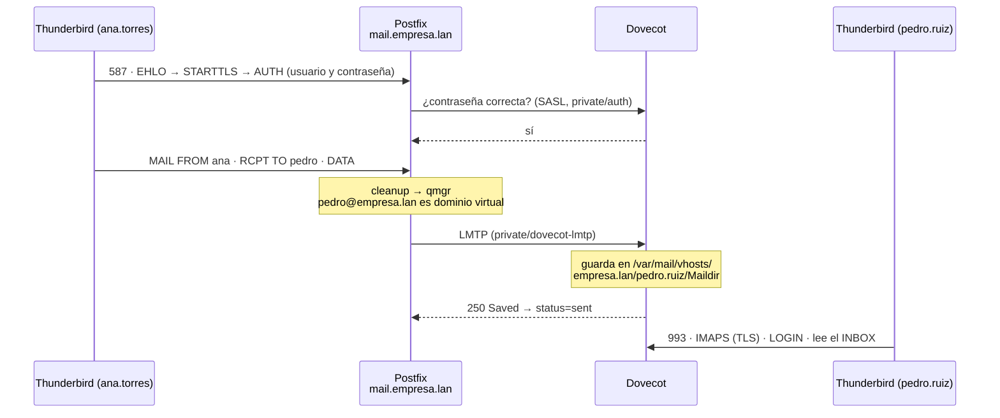

# Tarea 4.3 — Servidor de correo electrónico (SMTP/IMAP) con TLS

**Materia:** Administración de Servidores · **Unidad 4**
**Sistema probado:** Xubuntu 25.10 (VirtualBox) · Postfix 3.10 · Dovecot 2.4.1 · Thunderbird

Sobre el laboratorio de las tareas [4.1](../Tarea_4.1/) (DNS `empresa.lan`) y [4.2](../Tarea_4.2/) (CA local), el servidor `srv01` ofrece correo electrónico para el dominio `empresa.lan`:

- **MTA — Postfix:** recibe correo (SMTP, puerto 25) y permite que los usuarios envíen el suyo (puerto 587, con STARTTLS y contraseña).
- **MDA — Dovecot:** guarda cada mensaje en el buzón del destinatario (LMTP) y lo entrega a los clientes por **IMAPS** (puerto 993).
- **Buzones virtuales:** `usuario@empresa.lan`, sin cuentas de Linux, creados con `scripts/crear_buzon.sh`.
- **DNS:** registros **MX**, **A** de `mail.empresa.lan` y **SPF**.

---

## 1. Flujo de un mensaje



Cada paso queda registrado en **`/var/log/mail.log`**: `postfix/submission/smtpd` (conexión y `sasl_username`), `postfix/qmgr` (remitente), `postfix/lmtp` (`status=sent`) y `dovecot: lmtp(...)` (`saved mail to INBOX`).

## 2. Puertos y seguridad

| Puerto | Servicio | Uso | Seguridad |
|---|---|---|---|
| 25/TCP | Postfix `smtp` | Correo que llega de otros servidores | STARTTLS ofrecido; solo acepta destinatarios de `empresa.lan` (sin relay abierto); rechaza buzones inexistentes |
| 587/TCP | Postfix `submission` | Envío desde Thunderbird | **TLS obligatorio**, autenticación obligatoria, cada usuario solo envía con su propia dirección |
| 993/TCP | Dovecot `imaps` | Leer el correo | **TLS desde el inicio**; 143 y 110 (sin cifrar) desactivados |

- Las contraseñas nunca viajan sin cifrar: `smtpd_tls_auth_only = yes` y `auth_allow_cleartext = no`.
- Se guardan cifradas con **SHA512-CRYPT** en `/etc/dovecot/usuarios`.
- El certificado de `mail.empresa.lan` lo firma la **CA local** de la Tarea 4.2, en la que los clientes ya confían.
- En el laboratorio no hay salida a servidores de correo de internet, así que los mensajes a otros dominios se rechazan de inmediato (`default_transport = error:...`).

## 3. Registros DNS

| Nombre | Tipo | Valor | Origen |
|---|---|---|---|
| empresa.lan | MX | 10 mail.empresa.lan. | Tarea 4.1 |
| mail.empresa.lan | A | 192.168.50.10 | Tarea 4.1 |
| empresa.lan | TXT | `v=spf1 mx -all` (**SPF**) | Esta tarea |
| _dmarc.empresa.lan | TXT | `v=DMARC1; p=none; rua=mailto:postmaster@empresa.lan` | Esta tarea |
| smtp, imap | CNAME | mail | Esta tarea |

**SPF** indica qué servidores pueden enviar correo de `empresa.lan`: solo los del registro MX (`mx`). Cualquier otro debe rechazarse (`-all`).

`01_dns_correo.sh` agrega estos registros a la zona entre marcas `BEGIN/END TAREA43` y aumenta el serial. Si vuelves a ejecutar `03_dns.sh` de la Tarea 4.1, vuelve a ejecutar también este script.

## 4. Buzones

| Dirección | Buzón real |
|---|---|
| ana.torres@empresa.lan | sí |
| pedro.ruiz@empresa.lan | sí |
| maria.lopez@empresa.lan | sí |
| carlos.vega@empresa.lan | sí |
| postmaster@, abuse@, admin@, soporte@ | alias → ana.torres |
| finanzas@ | alias → maria.lopez y pedro.ruiz |

```bash
sudo bash scripts/crear_buzon.sh luis.rios              # alta (contraseña generada)
sudo bash scripts/crear_buzon.sh luis.rios Clave2026    # alta o cambio de contraseña
sudo bash scripts/crear_buzon.sh --listar               # buzones, mensajes y alias
sudo bash scripts/crear_buzon.sh --eliminar luis.rios   # baja (guarda copia del buzón)
sudo cat /root/tarea43_credenciales.txt                 # contraseñas
```

## 5. Estructura del repositorio

```
Unidad_4/Tarea_4.3/
├── config/
│   ├── postfix/
│   │   ├── main.cf              # MTA: dominio virtual, TLS, SASL, anti relay
│   │   ├── master.cf            # servicios: smtp (25) y submission (587)
│   │   └── alias_virtuales      # postmaster@, admin@, finanzas@...
│   ├── dovecot/dovecot.conf     # MDA: LMTP, IMAPS, usuarios virtuales (sintaxis 2.4)
│   ├── ssl/mail.cnf             # certificado de mail.empresa.lan
│   └── dns/registros_correo.zona  # SPF, DMARC y alias DNS
├── data/buzones.csv             # buzones iniciales
├── scripts/
│   ├── lib/comun.sh
│   ├── 00_ejecutar_todo.sh      # 01 → 02 → 03 → 04 → 05 → 99
│   ├── 01_dns_correo.sh         # registros DNS del correo
│   ├── 02_certificado_correo.sh # certificado firmado por la CA local
│   ├── 03_postfix.sh            # Postfix (va antes: crea la carpeta de los sockets)
│   ├── 04_dovecot.sh            # Dovecot + usuario vmail + rsyslog
│   ├── 05_buzones.sh            # crea los buzones del CSV
│   ├── crear_buzon.sh           # alta, cambio de contraseña y baja de buzones
│   ├── 98_revertir.sh           # deshace todo (no toca 4.1 ni 4.2)
│   ├── 99_validar.sh            # pruebas automáticas (servidor)
│   └── cliente_pruebas.sh       # pruebas desde la VM cliente
├── docs/
└── evidencias/                  # se crea al ejecutar 99_validar.sh
```

## 6. Uso

### En el servidor

Requiere las tareas 4.1 y 4.2 funcionando.

```bash
cd <tu-repo>/Unidad_4/Tarea_4.3
sudo bash scripts/00_ejecutar_todo.sh
sudo cat /root/tarea43_credenciales.txt

# Seguir el correo en tiempo real
sudo tail -f /var/log/mail.log
```

### En el cliente

```bash
bash scripts/cliente_pruebas.sh confiar-ca   # una vez: Thunderbird confía en la CA
bash scripts/cliente_pruebas.sh dns          # MX, A y SPF
bash scripts/cliente_pruebas.sh tls          # certificado en 587 y 993
bash scripts/cliente_pruebas.sh enviar       # envía un correo por SMTP con TLS
bash scripts/cliente_pruebas.sh bandeja      # lee un buzón por IMAPS
```

### Thunderbird (configuración manual)

| | Servidor | Puerto | Seguridad | Autenticación | Usuario |
|---|---|---|---|---|---|
| **Entrante (IMAP)** | mail.empresa.lan | 993 | SSL/TLS | Contraseña normal | ana.torres@empresa.lan |
| **Saliente (SMTP)** | mail.empresa.lan | 587 | STARTTLS | Contraseña normal | ana.torres@empresa.lan |

Agrega dos cuentas, por ejemplo `ana.torres` y `pedro.ruiz`, y envía correos de una a otra.

## 7. Pruebas de verificación

| Prueba | Comando | Resultado esperado |
|---|---|---|
| MX y SPF | `dig empresa.lan MX` · `dig empresa.lan TXT` | `10 mail.empresa.lan.` · `"v=spf1 mx -all"` |
| STARTTLS | `cliente_pruebas.sh tls` | Certificado de mail.empresa.lan emitido por la CA, `Verify return code: 0` |
| Sin relay abierto | `swaks --to alguien@gmail.com --server mail.empresa.lan` | `554 Relay access denied` |
| Sin AUTH en claro | EHLO al 587 sin TLS | No aparece `AUTH` |
| Suplantación | Ana intenta enviar como Pedro | `Sender address rejected` |
| Envío y recepción | Thunderbird: Ana → Pedro | El mensaje llega a la bandeja de Pedro |
| Trazabilidad | `sudo tail -f /var/log/mail.log` | `sasl_username=ana...` → `status=sent` → `saved mail to INBOX` |
| IMAPS | `cliente_pruebas.sh bandeja` | Lista de mensajes del buzón |

## 8. Notas

- **Dovecot 2.4** cambió la sintaxis respecto a la 2.3 de la mayoría de los tutoriales. Por ejemplo: `ssl_server_cert_file` en lugar de `ssl_cert = <`, `mail_driver` y `mail_path` en lugar de `mail_location`, `auth_allow_cleartext` en lugar de `disable_plaintext_auth`, y variables `%{user | domain}`.
- Postfix y Dovecot **no aceptan comentarios al final de una línea**; todos van en su propia línea.
- `04_dovecot.sh` instala **rsyslog**, que es el que escribe `/var/log/mail.log`.
- Si los scripts dan error `$'\r': command not found`, conviértelos a fin de línea Unix con `sed -i 's/\r$//' scripts/*.sh scripts/lib/*.sh`.
